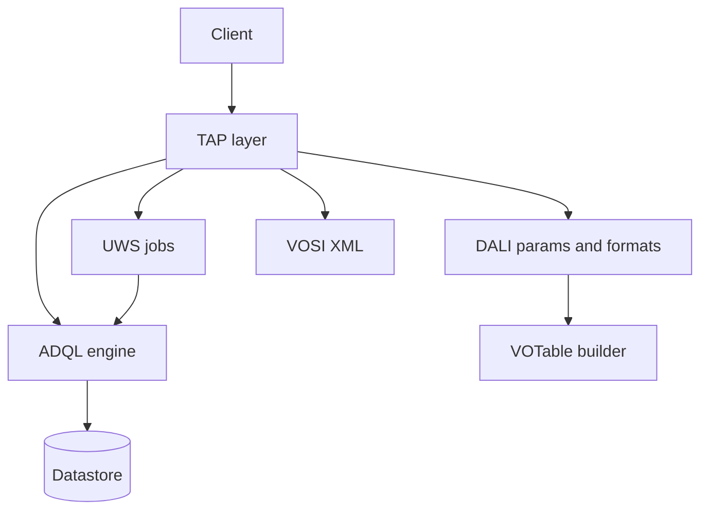

# Related IVOA standards (TAP 1.1 dependencies)

TAP §1.1 defines normative relationships. Use the linked REC as authority for details TAP defers.

## ADQL 2.0

- **Document:** [REC-ADQL-2.0](https://www.ivoa.net/documents/ADQL/20081030/REC-ADQL-2.0.html) (2008-10-30)
- **TAP role:** Mandatory query language (`LANG=ADQL`); `QUERY` carries ADQL text (TAP §2.7.1–2).
- **Implementation focus:** Parser/validator; table/column identifiers; `TOP`; spatial functions as supported; delimited identifiers for UPLOAD columns (TAP §2.7.6).
- **Optional surface:** TAPRegExt documents UDFs, geometric function support, and non-ADQL languages.

## UWS 1.1

- **Document:** [REC-UWS-1.1](http://www.ivoa.net/documents/UWS/) (2016-10-24; DOI [2016ivoa.spec.1024H](http://doi.org/10.5479/ADS/bib/2016ivoa.spec.1024H))
- **TAP role:** Async query control on `/async` and job sub-resources (TAP §2.2).
- **Implementation focus:** Job phases (`PENDING`, `QUEUED`, `EXECUTING`, `COMPLETED`, `ERROR`, `ABORTED`); job list POST → job id; `parameters` accumulation; `results` list; `error` document; optional `WAIT` (UWS 1.1).
- **TAP-specific:** Result name `result` for single-table ADQL outputs.

## DALI 1.1

- **Document:** [REC-DALI-1.1](https://www.ivoa.net/documents/DALI/) (2017-05-17; [2017ivoa.spec.0517D](https://ui.adsabs.harvard.edu/abs/2017ivoa.spec.0517D))
- **TAP role:** TAP written against DALI 1.1 (TAP §1.1).
- **Delegated behaviour (non-exhaustive):**
  - DALI-sync and DALI-async resource patterns
  - `RESPONSEFORMAT`, `MAXREC`, `RUNID`, `UPLOAD`
  - Error document shape and format negotiation
  - Overflow reporting in VOTable and other formats
  - Geometry and timestamp literals in queries/results
  - `/examples` capability `ivo://ivoa.net/std/DALI#examples`
  - VOSI-availability placement and semantics
- **Implementation focus:** Read DALI sections referenced from TAP before implementing any of the above; do not duplicate DALI with TAP-only variants.

## VOSI 1.1

- **Document:** [REC-VOSI-1.1](https://www.ivoa.net/documents/VOSI/20170524/REC-VOSI-1.1.html) (2017-05-24)
- **TAP role:** `capabilities`, `availability`, `tables` discovery (TAP §2.3–2.5).
- **Skill:** [ivoa-vosi](../ivoa-vosi/SKILL.md) — servlet wiring, XML shapes, `CapabilitiesTest` / `AvailabilityTest`, tables binding.
- **Implementation focus:** Embed TAP capability in the same `capabilities.xml` as VOSI self-capabilities; implement `/tables` per VOSI 1.1 when deployed; do not re-specify VOSI HTTP rules in TAP-only code.

## VOTable 1.2+

- **Document:** [REC-VOTable-1.3](https://www.ivoa.net/documents/VOTable/20130920/REC-VOTable-1.3.html) (2013-09-20); TAP requires ≥1.2 features
- **TAP role:** Mandatory default output; UPLOAD input format (TAP §2.7.3, §2.7.6, §3).
- **Implementation focus:** `RESOURCE type="results"`; `FIELD@name`, `@datatype`, `@arraysize`, `@xtype`; `INFO` for overflow (via DALI); error VOTable; upload round-trip (TAP §3.2, §3.5).

## TAPRegExt 1.0

- **Document:** [REC-TAPRegExt-1.0](http://doi.org/10.5479/ADS/bib/2012ivoa.spec.0827D)
- **TAP role:** Not formally required for TAP compliance; **SHOULD** in production capabilities (TAP §1.1, §2.4).
- **Content:** Output formats, limits, language support, UDFs, upload policies.

## SSO 2.0

- **Document:** [REC-SSO-2.0](https://ui.adsabs.harvard.edu/abs/2017ivoa.spec.0524T)
- **TAP role:** `securityMethod` standardIDs on TAP interface when auth supported (TAP §2.4).

## CDP 1.0

- **Document:** Credential delegation when UPLOAD URLs need delegated credentials (TAP §1.1).

## Responsibility split (implementation)

Keep UWS/DALI/TAP HTTP handling thin; push SQL generation and storage to the ADQL/DB boundary.

## Specification reading order

1. TAP §2 Resources + §2.7 Parameters for the feature
2. DALI section cited by that TAP subsection
3. UWS for anything under `/async/{id}/*` not spelled out in TAP
4. ADQL for language semantics
5. VOTable + TAP §3 for serialization
6. TAP §4 for metadata tables and VOSI-tables parity
